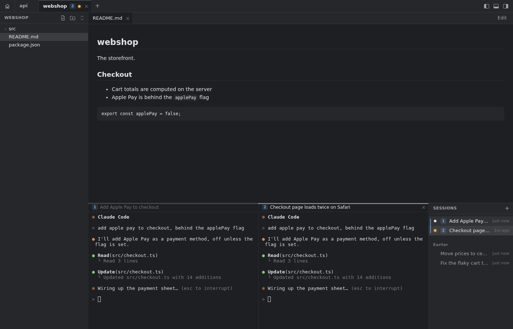
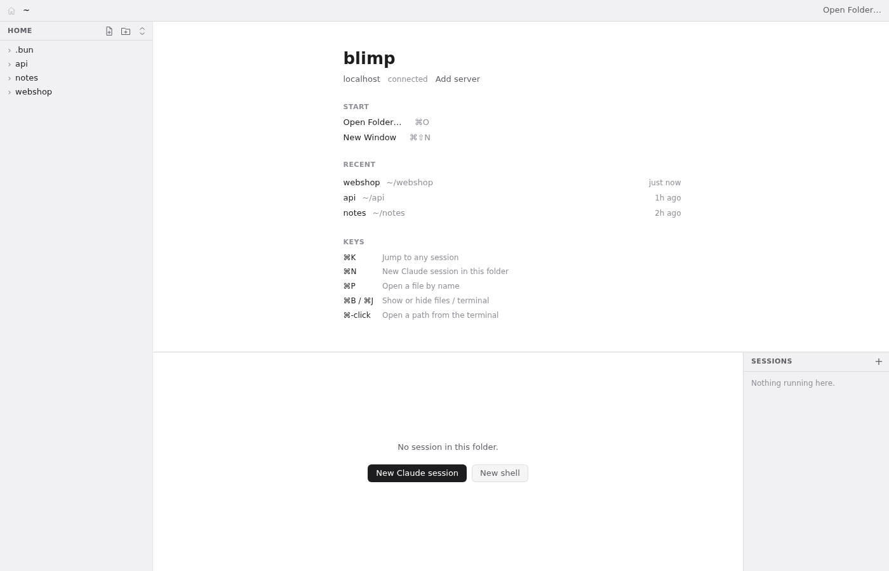

# blimp

blimp is a Mac app for Claude Code sessions that run on your own Linux server. It is laid out like VS Code: you open a project folder on the server, its files are on the left, the files you open are in tabs, and the terminal is at the bottom. Next to the terminal is the list of Claude sessions in that folder, with what each one is doing. Click a session to use its terminal, as if you had connected with SSH. You do not need to keep a terminal open, and you do not need another editor.



blimp follows the system setting for light or dark mode. See the [light mode screenshot](docs/screenshots/main.png).

These screenshots come from the browser build that the end-to-end tests use. The sessions in them are made up.

## How it works

- The app runs your normal `ssh` command. It uses your keys, your SSH agent and your `~/.ssh/config`.
- On the server, a small service called **blimpd** listens on a private unix socket (`~/.blimp/blimpd.sock`). It does not open a network port. The app forwards a local port to that socket through SSH.
- Sessions run in **zmx**, a small program that keeps terminal sessions alive. When you close the app, your sessions keep running on the server. With user systemd, this needs linger (see [Requirements](#requirements)).
- blimp is one more way to attach to those sessions. A plain terminal still works at the same time. On the server, `zmx list` shows the same sessions, and `zmx attach <name>` joins one. If you type in one place, the text shows in both places.

There is also an iPhone app. It shows your sessions and their chat, and you can answer prompts and talk to Claude by voice. It is not released yet. See [ios/README.md](ios/README.md).

The server can also answer a prompt without the terminal. The phone sends the answer, and blimpd types the same keys you would. It types them only if Claude still asks the same thing. If you already answered on the Mac, nothing is typed. "No, because…" is one step: blimpd presses Esc, then types your reason as a message. A permission prompt also says what Claude wants to run or change: the whole command, the file, or the web address. A command that pushes, deploys, force-resets or deletes things is marked as risky.

**Pair your iPhone.** On the server, run `blimpd pair`. It prints a QR code and a `blimp://` link. On the iPhone, open blimp and tap Scan QR code, or paste the link. The phone gets its own token, separate from the Mac's. To cut the phone off, run `blimpd pair --revoke` on the server. The Mac keeps working. The phone reaches the server through Tailscale, so `blimpd pair` takes the server's address from Tailscale. Without Tailscale, give the address yourself: `blimpd pair --url <address>`.

**Notifications on the iPhone.** blimpd sends them straight to Apple with your own push key. To set it up once:
1. In Apple's developer site (Certificates, Identifiers & Profiles), open Keys and add one with "Apple Push Notifications service (APNs)" ticked (Sandbox & Production). Download the `.p8` file (Apple lets you download it only once) and note its Key ID. Your Team ID is under Membership.
2. Copy it to the server, then run `blimpd push-key AuthKey_XXXXXXXXXX.p8 --key-id XXXXXXXXXX --team-id YYYYYYYYYY`. You can delete the file afterwards.
3. Open blimp on the iPhone and allow notifications, then run `blimpd push-test`. It prints Apple's answer for each phone.

The notification's text (a session's title, a command, a question, the start of a reply) shows on the lock screen. To hide it until Face ID: iOS Settings > Notifications > Show Previews > When Unlocked.

**Visuals.** A session can show you a chart, a diagram or a small report. Ask Claude for one: it writes a web page and calls blimp's show tool. The phone's chat gets a card that opens it full screen, and the Mac opens it in a tab of that project. Pages run locked down, with no internet; blimp gives them its colours, a chart library and a diagram library. blimpd keeps each one for 30 days. The first show in a session asks permission, as other tools do; allow it for the session (or always) to skip the question.

**A feed of what's new in tech, on the iPhone.** It is off by default. blimpd can fetch Hacker News, Reddit, GitHub trending and release notes every hour. The iPhone shows them one card at a time, each with a short summary that the small Claude model writes on your own sign-in (at most 6 calls an hour). To turn it on, add `"feed": { "on": true }` to `~/.blimp/config.json`. If there's no such file, make one with `{ "feed": { "on": true } }`. The same place takes your own lists: `"subreddits"`, `"rss"` (feed addresses) and `"interests"` (cards about these come first). Reddit needs a key. At https://www.reddit.com/prefs/apps, create an app of type "script" (any redirect address, for example `http://localhost`). Then run `blimpd reddit-key <client id> <secret>` on the server. Without a key, the feed skips Reddit and says so after the last card.

## Requirements

**Server**

- Linux on x86_64 or arm64.
- [Claude Code](https://docs.anthropic.com/en/docs/claude-code), on the `PATH` of your login shell. blimp starts each session as `claude`, through your login shell, in the folder you choose.
- A Claude Code login on the server. Run `claude` on the server once and log in. If you do not, each new session in blimp shows Claude's login steps instead of a prompt.
- An SSH server that allows forwarding to a unix socket. The app needs this to reach blimpd. It is on by default. A hardened `/etc/ssh/sshd_config` can turn it off with `AllowStreamLocalForwarding no` (or `remote`), or with `DisableForwarding yes`. To check, run `sudo sshd -T | grep -i forwarding` on the server. It must show `disableforwarding no`, and `allowstreamlocalforwarding` must be `yes`, `all` or `local`.
- `curl`, `tar` and `sha256sum`. Most Linux systems have them.
- Optional, for browser tabs: Chrome or Chromium; and for the browser sessions can use, also `npx` (Node.js) on the `PATH` of your login shell. If you have neither Chrome nor Chromium, `npx playwright install chromium` installs one. Run `blimpd browser` to see which one blimp found.
- User systemd (`systemctl --user`). This is recommended. If you have it, the installer runs blimpd as a user service. If you do not have it, you must start blimpd yourself, and start it again after each reboot.
- Linger, if you use systemd. This is strongly recommended.
  - Without linger, systemd stops blimpd when your last SSH connection to the server ends. That also ends every session that blimpd started. The app's own connection counts. So if you quit blimp and no other SSH connection is open, your sessions end.
  - To turn linger on: `sudo loginctl enable-linger "$USER"`. To check it: `loginctl show-user "$USER" -p Linger`.
  - Turning linger on usually needs root. If you do not have sudo, ask the server's admin to run `loginctl enable-linger <your user name>` as root.

**Mac**

- macOS 11 (Big Sur) or later, with Safari 16 or later installed. macOS 13 (Ventura) and later come with Safari 16 or later.
- SSH with a key, and no password prompt. blimp runs `/usr/bin/ssh` with `BatchMode=yes`, so ssh never asks you anything. Test this in Terminal first. This command must print `ok` without a prompt:
  `/usr/bin/ssh -o BatchMode=yes yourserver echo ok`
- The server's host key must be in `~/.ssh/known_hosts` already. Connect once from Terminal and accept the key.

## Install the server part

Run this on the server, as your normal user (not root):

```sh
curl -fsSL https://raw.githubusercontent.com/mbeato/blimp/main/install.sh | sh
```

The script does these things (see [install.sh](install.sh)):

1. It stops if the system is not Linux, or the CPU is not x86_64 or arm64, or `curl` is missing.
2. It installs into `~/.local/bin`. It does not need root.
3. **zmx:** if you already have zmx, the script keeps it. If not, it downloads zmx 0.8.1 from zmx's GitHub releases. It checks the download against a SHA-256 sum that is written in the script, and stops if the sum does not match.
4. **blimpd:** it downloads `blimpd-linux-x64` or `blimpd-linux-arm64` from the latest blimp release on GitHub. It also downloads `SHA256SUMS` from the same release, and stops if the binary does not match.
5. **Claude Code hooks:** it runs `blimpd install-hooks`. This adds blimp's status hooks to `~/.claude/settings.json` (or `$CLAUDE_CONFIG_DIR/settings.json`). It keeps all your other settings and hooks. Before the first change, it saves a copy as `settings.json.blimp-backup`. These hooks tell blimp the moment a session starts to wait for you. If you use Codex on the server (`~/.codex` exists), it also adds blimp's hooks to `~/.codex/hooks.json` the same way (backup `hooks.json.blimp-backup`), after any hooks you have there. Codex runs a new hook only after you trust it: the first time Codex says hooks need review, open `/hooks` in Codex and trust blimp's. Your `notify` setting in `~/.codex/config.toml` is not touched.
6. It tells you if `claude` is not found. It does not install Claude Code for you.
7. **Service:** if user systemd works, it writes `~/.config/systemd/user/blimpd.service`, then enables and starts it. If not, it prints the command to start blimpd yourself.
8. It prints this server's own name and your user name. In the app, enter the name that you use with ssh. That name can be different: for example an alias from `~/.ssh/config`, a full domain name, or an IP address.

To read the script before you run it:

```sh
curl -fsSL https://raw.githubusercontent.com/mbeato/blimp/main/install.sh -o blimp-install.sh && less blimp-install.sh
```

Then run it with `sh blimp-install.sh`. After that, you can delete `blimp-install.sh`.

To check the service: `systemctl --user status blimpd`. To list sessions from the command line: `~/.local/bin/blimpd sessions`.

## Install the app

Download the `.dmg` file from [GitHub Releases](https://github.com/mbeato/blimp/releases). Open it and drag **blimp** to Applications. It runs on Macs with Apple chips (M1 and later), not Intel Macs.

The release notes say whether the app is signed and notarized. If it is not, it has only an ad-hoc signature.

- **Signed build:** open it like any other app. No extra step.
- **Unsigned build:** macOS blocks the first launch. The ad-hoc signature makes macOS offer "Open Anyway" instead of saying the app is damaged.
  1. Open blimp once. macOS shows a warning. Close the warning.
  2. Open System Settings > Privacy & Security. Scroll down and click **Open Anyway** next to the message about blimp. Confirm.
  3. On macOS 14 and earlier, you can also Control-click (or right-click) blimp in Applications and choose **Open**. macOS 15 removed this shortcut, so use step 2 there.
  4. Last resort, in Terminal: `xattr -dr com.apple.quarantine /Applications/blimp.app`

**Updates.** blimp checks for a new version when it opens and every few hours; **blimp > Check for Updates…** checks now. When one is ready, a bar says so: click **Restart to update**. The app downloads it, checks that it was signed by this repository's release build, and restarts into it. Your sessions keep running on the server meanwhile.

When the app is newer than blimpd on a server, a bar offers **Update server**: it runs the latest release's install script on the server over SSH, the same as the install command above. Sessions keep running; blimp reconnects by itself.

## First run

1. Open blimp. It shows **Add a server**.
2. Enter the **Host**: the same name you type after `ssh`. A `Host` alias from `~/.ssh/config` works. This is not always the name that the installer printed.
3. **User** and **Port** are optional. Leave them empty to use what your `~/.ssh/config` says, as `ssh` does.
4. Click **Add server**.

blimp opens on **Home**: your home folder on the server. The Welcome page shows "connecting…", then "connected". If the connection fails, it shows the error and two buttons: **Try again** and **Remove server**. See [Troubleshooting](#troubleshooting).



To add more servers, click **Add server** on the Welcome page. The app keeps your server list on the Mac.

## Using it

**Projects and windows**

- Each open folder is a **tab** along the top of the window. Below it is that folder's own row of file tabs. A tab keeps its open files and terminals while you look at another one.
- **Home** is the first tab: your home folder on the server. Its Welcome page lists your recent projects. With more than one server, it has a server picker.
- **Open Folder…** (⌘O, or the **+** after the tabs) picks a folder: from the folders you used Claude in, by browsing the server, or by typing a path (like `~/projects/app`). While browsing, **New folder** makes a folder and goes into it. The folder opens in a new tab, or its tab comes to the front if it's already open.
- Drag a tab to move it. Home stays first.
- Close a tab with its **×** or a middle-click. Its sessions keep running. An amber dot on a tab means a session in that folder is waiting for you.
- blimp reopens every window you had open, with its tabs, where it was on screen, the next time you open it. A window you closed yourself (not by quitting) doesn't come back.
- **⌘⇧N** opens a new window, on Home. Each window has its own tabs.

**The window**

- **Left:** the folder's files. Click a folder to open it, and a file to open it in a tab. The buttons at the top make a **new file** or a **new folder** in the folder you last clicked, and fold every folder.
- **Top right:** the files you opened, one tab each. With no file open, the terminal fills the right side (on Home, the Welcome page shows instead).
- **Bottom right:** the terminal, with the folder's sessions next to it. Drag the line above it to make it taller or shorter.
- **The three buttons at the top right** show or hide the files (⌘B), the terminal (⌘J) and the session list (⌘⌥B), as in VS Code.

**Sessions**

- The list next to the terminal shows the sessions in this folder only, as `claude --resume` shows only this folder's conversations. A session started in a subfolder shows when you open that subfolder.
- Each running session shows its title and a mark: a spinning ring means **working**, an amber dot means **waiting for you**, an empty ring means **idle**. A plain shell shows `>_` and its session name. The title is your `/rename` title, else blimp's own name for it, else Claude's title, else the first prompt. Codex sessions get the same marks (from blimp's Codex hooks) and show their session name.
- A session of another kind has a small label after its title: **GLM** (Claude Code on GLM), **Codex**, **Codex sign-in**, or the label of one of your own kinds.
- Click a session to show its terminal. When you open a folder, blimp shows the session that waits longest for you, else the newest.
- **Drag a session onto the terminal** to see it side by side with the one there. Drop it on the left or right half; drag again (its row, or the name on top of its split) to move it. **×** on a split closes the split (the session keeps running). Esc cancels a drag.
- **Drag a session out of the window** to move it: let go over another blimp window and it goes into that window's tab for its folder, where you let go; let go anywhere else and it opens in a new window there. Drag it back the same way.
- **Right-click a session** (its row, or the name on top of its split) for **Open in New Window**, and, on a split, **Open All Splits in New Window**. The session moves; this window stops showing it. A session in a split (on screen or kept) also has **Unsplit**: each of the split's sessions is on its own again, and the one you right-clicked stays on screen if the split was. **Copy Reference** copies a short note about the session: its title, folder, where its conversation is saved, and `blimpd send <session> "<message>"`. Paste it into another session and that Claude can read what this one did, and send it a message if it needs to.
- **Continue a session in a new one.** A long session fills Claude's context window. Then Claude forgets older parts of the work. Right-click a Claude session and pick **Continue in New Session**. blimp asks Claude to write a handoff: the goal, what is done, what is left, the key files and commands, and what went wrong. Claude saves it as `notes/<date>/HANDOFF-<name>.md` in the session's folder. While Claude writes, the row says "Writing handoff". Then blimp starts a new session of the same kind in the same folder. Its first message is "Read <the file> and do it". The new session opens in a split to the right. The old row says "Handed off". The new row has a small ↳ before its title; point at it to see which session it came from. It doesn't work while Claude asks you something: answer first. If no file comes back in 20 minutes, blimp says so.
- **How full the context window is.** When a Claude session has used half of its context window, a thin bar shows along the bottom of its row. The bar is as long as the part that is used. It turns red at 80%: a good time to continue in a new session. Point at the row to see the numbers, for example "Context 62% (620k of 1M tokens)".
- The files, the session list and each split are as wide as you drag the line beside them.
- **Splits are groups, as in VS Code's terminal.** Click any session of a split group and the whole group shows, with that one focused. Click a session outside it and that session shows on its own; the group stays together, and a click on either of its sessions brings it back. In the list, the group on screen comes first, joined by a blue line and numbered like its splits' headers; other split groups follow, dimmer. A project tab says how many sessions it shows side by side.
- A session another blimp window shows is listed only in that window, not in this one. ⌘K still finds it and takes you there.
- **Shift+Enter** starts a new line in a Claude session, as in VS Code (it sends what Claude reads as Option+Enter). In a plain shell it's Enter.
- **blimp names Claude sessions itself.** Claude's own title comes from the first message, so it says how a session started. Now and then blimp asks a small, fast Claude model (haiku) for a name in 2 to 4 words that says what the session works on now, and asks again as the work moves on (after 3 more prompts and 20 minutes at the least, and at most 30 times an hour). It runs on your own Claude sign-in, so it uses a little of your Claude usage. Your own `/rename` always wins. To turn it off, put `{ "names": false }` in `~/.blimp/config.json` on the server.
- **+** (or **⌘N**) starts a new Claude session in this folder. The arrow next to it lists every kind of session the server can start:
  - **Claude Code**: the same as +.
  - **Claude Code on GLM**: Claude Code on Z.ai's GLM models, with your Z.ai key (set it in Settings > Models). Greyed until the server has a key.
  - **Codex**: OpenAI's Codex CLI, with "signed in" or "not signed in" under it. Greyed if `codex` isn't installed on the server.
  - Your own kinds, from `~/.blimp/kinds.json` on the server (see below).
  - **Shell**: a plain terminal in this folder, with your login shell and no Claude.
  - **Models and keys…** opens Settings at Models.

  A kind that can't start says why under its name. blimp looks for `claude` and `codex` the way your login shell does, so ones that nvm or `~/.local/bin` put on PATH are found.
- **Background jobs.** Claude can start work that runs on while it talks: a command in the background, a Monitor, an agent or a workflow. The session's row counts the ones that still run, like "Working · 2 jobs". After the last one ends, it says "job done" for 30 minutes. Click those words to see each job: what it does, how long it has run (or how it ended, with the exit code), and a running command's last line of output. The output file itself is not shown: Claude keeps it in `/tmp` on the server, and blimp only reads files in your home folder.
- **Earlier** lists this folder's past conversations that are not running, with how many there are. Click it to unfold or fold the list (blimp remembers which), and click a conversation to resume it in a new session.
- Hover a session and click the trash icon to end it. An idle Claude session ends at once; its conversation is saved, so you can resume it from **Earlier**. A session that is working or waiting, or a shell, asks first.
- blimp starts every session in the real folder on the server, the same as typing `claude` there. So Claude reads that project's CLAUDE.md and settings.
- Closing the window or quitting blimp only detaches. Sessions keep running on the server. A reboot of the server ends them. With user systemd and linger, blimpd starts again by itself after the reboot.
- If you detach with `ctrl+\` (zmx's detach key), the terminal shows "Detached" and a **Reattach** button. If the connection drops, the terminal reconnects by itself.
- **⌘K** searches all sessions on all servers, by title, folder and name. Pick one and blimp shows it in its folder's tab. If another window has that folder open, that window comes to the front; else the folder opens in a new tab here.
- **Which session is on what.** blimp shows which git branch each Claude session works on. Hover a session to see its branch, and "(worktree)" when the folder is a git worktree. ⌘K shows the branch next to the folder.
  - **Right-click a session** for **Open PR #12**: the branch's pull requests (the newest 3, open or closed) open in your browser. blimp asks GitHub's `gh` on the server, at most every 5 minutes. Without `gh`, or when you're not signed in to it, there are no PR items.

**Running commands Claude gives you**

- When Claude's latest reply has commands for you to run, a slim **Run** bar shows above its terminal. A Claude session's terminal always leaves room for the bar at its top, so the bar covers no text, and it doesn't resize the terminal when it comes or goes. A command is a code block marked `bash`, `sh`, `shell`, `zsh` or `console`, or a short piece of code that starts with `!` (as in `! bash /tmp/x.sh`) or with a command such as `bun`, `npm`, `npx`, `node`, `python`, `sh` or `cd`. If a code block shows `$` prompts, only the lines after a `$` are the command; the rest is output. A `cd` on its own isn't offered.
- The bar shows up to 3 commands, newest first, or fewer in a narrow split. **+N** lists the others. Hover a command to read all of it before you run it.
- Nothing runs until you click it. A click on a command runs it in a new session of its own, in a split to the right of Claude's. It runs in the folder Claude works in, with your login shell, as if you typed it there. It has no time limit, and closing blimp doesn't stop it.
- **Ctrl-C** in its split stops the command (exit 130) and keeps the split. If Ctrl-C does nothing, press another key first (a letter), then Ctrl-C again. zmx takes keys from one device at a time, and a Ctrl-C alone doesn't make a device that one. With zmx 0.5, this can happen right after a split opens; zmx 0.8.1 doesn't do that.
- When the command ends, its split shows `── exit N ──` and keeps a shell open, so you can read the output and go on typing. That shell starts in Claude's folder again: a `cd` or `export` in the command doesn't carry over. The session list shows it with the label **Run**.
- The bar then shows **exit N** and **Send result to Claude**. That types the exit code and the last 40 lines of the output into Claude's prompt and sends it. It doesn't type while Claude asks you something: answer first, then send. The bar goes when you next type to Claude; after that, right-click the run's split or row and pick **Send Result to Claude**.
- **×** hides the bar until Claude gives you other commands.

**Files**

- **⌘P** opens a file by name.
- **⌘-click a file path in the terminal** (like `src/app.ts` or `src/app.ts:42`) to open it in a tab, at that line. Paths are read from the session's folder. Only paths to files that exist become links.
- **Text and code** open in Monaco, the editor inside VS Code. It has the same keys, search and replace, and multi-cursor.
- **Edits save by themselves**, one second after you stop typing, and at once when you click away, switch files or switch apps. A dot on the tab means the latest edit is not saved yet. **⌘S** saves at once.
- **Markdown** shows rendered. Click **Edit** to change it and **Preview** to go back. A relative link opens that file in a tab. An `http` or `https` link opens in your default browser. Other links do not open.
- **HTML files** show as a web page. The page's images and stylesheets next to it show too. Its scripts do not run, and nothing on it loads from the web. A link to a part of the page scrolls to it; other links do nothing. When the file changes, the page shows the new version from the top. Click **Edit** to change it and **Preview** to go back.
- **Images** (png, jpg, jpeg, gif, webp, svg, ico, bmp) show fitted to the pane.
- **See a folder's images in one place:** right-click the folder and pick **Show as Gallery**. A tab shows all its images, newest first, with each name and how long ago it changed. New images show up by themselves. Click one to open it in its own tab.
- **PDF** files show all pages, with pdf.js.
- Other binary files show "Can't show this file" and the file size.
- The tree and the open files update when a session changes them.
- **Right-click a file or folder** in the tree, as in VS Code:
  - **Copy Path** copies its full path on the server. **Copy Relative Path** copies its path from the project folder (`src/app.ts`). Paste it into a session to tell Claude which file you mean.
  - **Send Path to Session** types the path into the session on screen (the focused split), at the prompt. It does not press Enter. A path with spaces or other shell characters is put in single quotes. With the terminal hidden, the item is off.
  - **Rename…** puts the name in a box in its row. The name without its extension is selected. Enter renames; Esc stops. A name that's already there is refused.
  - **Delete** asks first, with the name. A folder goes with everything in it. The server has no trash, so you can't undo it.
  - A folder also has **New File…** and **New Folder…** (they go in that folder), **Upload…**, **Download as .tar.gz** and **Show as Gallery**.
- **Keys on the tree row that has the focus** (a file or folder you clicked, or a row you reach with Tab; a file you click opens in the editor and the focus stays on its row, as in VS Code, so click in the editor to type): Enter or F2 renames, ⌘⌫ deletes (after asking), ⌥⌘C copies the path, ⌥⇧⌘C copies the relative path.
- **Drag a file or folder in the tree:**
  - Onto a session's terminal: its path is typed there, as with Send Path to Session.
  - Onto a folder (or a file in it): blimp asks "Move X into Y?", then moves it. Let go on the space below the rows to move it to the project folder. A folder can't go into itself.
  - Esc stops the drag.
- Open file tabs go with a rename or a move. A file deleted from the tree closes its tab.
- **Right-click a file tab** for **Download**, **Copy Path**, **Copy Relative Path**, **Send Path to Session** and **Reveal in Files** (opens the folders down to the file in the tree and selects it).

**Moving files between your Mac and the server**

- **Download:** right-click a file (in the tree, or its tab) and pick **Download**. It goes to your Downloads folder, next to anything already there (`name 2.txt`, not over it). A folder downloads as a `.tar.gz`; double-click it on the Mac to open it.
- **Upload:** drag files or folders from Finder onto the window. Over the tree, the folder under the pointer lights up and they go there; let go on a file, they go in its folder. Anywhere else in the window, they go in the folder you last clicked. Or right-click a folder and pick **Upload…**.
- A name that's already there asks first: **Replace**, **Keep both** (as `name 2.txt`) or **Skip**.
- **Drop a file on a Claude session** (a screenshot, say): it goes to `~/.blimp/uploads` on the server, and its path is typed into the prompt, so Claude can read it. What lights up while you drag is where it goes.
- **⌘V a screenshot** (after ⌃⇧⌘4) in a session does the same.
- The Mac app takes files only. A picture dragged straight from a web page or from Photos is not a file, so it can't be dropped; blimp says so. Save it as a file first (or drag it to the desktop), then drop the file. Screenshots and other files from Finder work.
- Transfers show at the bottom left, with their progress and **Cancel**. A finished download has **Show in Finder**.

**Browser tabs**

- Browser tabs run in a Chrome on the server, and blimp shows them live next to your files. Click, scroll and type in them as in any browser. ⌘C and ⌘V use your Mac's clipboard. The page's own pop-up questions (alert, confirm) show in a bar over it.
- ⌘T or the **+** after the tabs opens one at Google, and so does the globe at the top right while the folder has none. The address bar takes an address, or words to search Google for. **Open in Browser** opens the address on your Mac.
- Only the browser tab you're looking at streams to your Mac. Once the folder has browser tabs, the globe hides them, so nothing streams, and the pages keep running on the server. The globe again, or opening any browser tab, brings them back. Drag a browser tab to move it among the others. A minimized or covered blimp window streams nothing either.
- The tabs belong to the folder, and they stay on the server: any Mac you connect from shows the same tabs, and closing one closes it everywhere.
- When a program in one of the folder's sessions starts listening on a port (a dev server on `localhost:3000`, say), blimp says "Port 3000 is open" with **Open**. The session list shows every such port under **Ports**. **Open** shows `localhost:3000` in a browser tab: it's the server's own `localhost`, since the browser runs there.
- The picture comes over your SSH connection, so it's a little behind a local browser, and video isn't smooth. For everyday browsing, your own browser is better.
- Not yet: file downloads, and pages' file upload buttons.

**A browser for your sessions**

- Claude Code and Codex sessions that blimp starts can use the same browser. Ask Claude to open a page, and it can read the page's source, its network requests (headers and bodies) and its console. This uses Google's [Chrome DevTools MCP](https://github.com/ChromeDevTools/chrome-devtools-mcp). It needs Chrome or Chromium and `npx` on the server (see Requirements).
- A session sees only the tabs of its own folder: yours there, and the ones it opens (marked ● in the tab strip). Tabs it opens don't come to the front.
- **Send to session** on a tab pastes its title and address into a session, so you can ask about the page you're looking at.
- Sessions that were already running get the browser the next time they start.

**When a file changes on the server**

- If you have no edits waiting to be saved, the file reloads by itself. This is what you see when Claude edits a file you have open.
- If an edit of yours was not saved yet, a bar says "Changed on the server", with **Reload** and **Keep mine**. blimp does not save over the server's change by itself. **Reload** loads the server's version and drops your edit. **Keep mine** saves your version over the server's.

**Notifications and Dock badge**

- When a session starts waiting for you, blimp sends a Mac notification: "*title* is waiting for you", with the folder. It does not send one if a blimp window is in focus and shows that session. With several windows, you get one notification, not one per window.
- When a background job of Claude's ends (see Background jobs above), blimp sends "*job* finished" (or "*job* failed, exit 1"), with the session's title and folder. It sends this also when the session is on screen, so you know the build is done. It does not send it while that session's job list is open in a window in focus. A job that Claude stopped gets no notification.
- macOS asks for permission the first time blimp sends a notification.
- The Dock icon shows how many sessions wait for you, on all servers.

### Models and keys

Sessions run on the server, so keys and sign-ins live there too. **Settings > Models** has one part per connected server:

- **Z.ai key** (Set or Not set): paste the key and click **Save**. blimp sends it once to the server, which saves it in `~/.config/zai/key` (only you can read it), and clears the field. The app never keeps it, and the server never sends it back. **Remove** deletes it. With a key, **Claude Code on GLM** can start: Claude Code with the Z.ai endpoint and the GLM models (GLM-5.3, and GLM-5.3-Flash for fast work), the same settings as a `claude-glm` script.
- **Codex** (Signed in or Not signed in): **Sign in** closes Settings and starts `codex login --device-auth` in a session in the front tab's folder. Finish there: it shows a code to enter in your browser.
- Your own kinds of session live in `~/.blimp/kinds.json` on the server:

  ```json
  { "kinds": [{ "id": "review", "label": "Codex review", "command": ["codex", "--profile", "review"], "env": { "SOME_VAR": "x" } }],
    "glm": { "model": "GLM-5.3", "fast": "GLM-5.3-Flash" } }
  ```

  Each kind shows in the arrow menu by its label and runs its command in your login shell, in the folder. An `id` is letters, digits, `-` and `_`, and can't be a built-in one. `glm` changes the models Claude Code on GLM uses. If the file is wrong, blimp ignores all of it, and the menu says why.

### Secrets for Claude

Sometimes Claude needs a key or a password, for example to call an API. Do not paste it into the chat. The chat is saved on the server, so the key stays there.

- **Right-click a Claude session** and pick **Give a Secret…**.
- Type a **Name**, for example `OPENAI_API_KEY`. Paste the key into **Value** (a key of several lines, like a PEM or SSH key, keeps its line breaks). Then click **Save and Tell Claude**. A server whose blimpd is older than this feature says so, and saves nothing.
- blimp sends the key once to the server. The server saves it in `~/.blimp/secrets/<name>`. Only you can read that file. The field is cleared, and the app never keeps the key.
- Then blimp types a note to Claude. The note says where the file is and how to use it, for example `export OPENAI_API_KEY="$(cat ~/.blimp/secrets/OPENAI_API_KEY)" && your-command`, all in one command, since a variable set in one command is gone in the next. The note never has the key in it. It also tells Claude never to print the key or put it in a file, a commit or a message.
- To give the same secret to another session, type its name and leave **Value** empty. The button says **Tell Claude**.
- If Claude is asking you something, blimp does not type the note. Answer Claude first, then click **Tell Claude**.
- **Settings > Models** shows the names of the secrets on each server. **Remove** deletes one. The server never sends a secret back, and the files on the left cannot open, download or replace them.

### Keyboard shortcuts

| Keys | What it does |
|---|---|
| ⌘K | Jump to any session by its title, folder or name. In the editor, ⌘K goes to the editor (its ⌘K chords, as in VS Code). |
| ⌘N | New Claude session in this folder. |
| ⌘⇧N | New window. |
| ⌘O | Open Folder…: pick a folder on the server, in a new tab. |
| ⌘P | Open a file by name in this folder. |
| ⌘S | Save the open file now (edits also save by themselves). |
| ⌘W | Close the open file tab. The session and the window stay. |
| ⌘, | Settings: theme, text sizes, terminal cursor and scrollback, Option as Meta, autosave, word wrap, minimap, notifications, Dock badge, models and keys, automatic update checks. |
| ⌘B | Show or hide the files on the left. |
| ⌘J | Show or hide the terminal. |
| ⌥⌘C / ⌥⇧⌘C | On the focused row in the files: copy its path / its path from the project folder. |
| Enter or F2 | On the focused row in the files: rename it. |
| ⌘⌫ | On the focused row in the files: delete it (after asking). |
| ⌘⌥B | Show or hide the session list. |
| ⌘-click | In the terminal: open a file path in a tab, or a web link in your browser. |
| Esc | Close a dialog. |
| ↑ ↓ Enter | Move and pick in the session search and the dialogs. |
| ⌘Q | Quit blimp. Sessions keep running on the server. |

In the terminal, keys work like the VS Code terminal on macOS:

| Keys | What it does |
|---|---|
| ⌘C | Copy the selected text. |
| ⌘V | Paste. |
| ⌘⌫ | Delete to the start of the line (sends ctrl+U). |
| ⌥⌫ | Delete the word before the cursor (sends ctrl+W). |
| ⌘← / ⌘→ | Go to the start or end of the line (ctrl+A / ctrl+E). |
| ⌥← / ⌥→ | Go one word left or right (Esc b / Esc f). |
| `ctrl+\` | Detach (zmx). The session keeps running. |

A ⌘-click on a web link in the terminal opens it in your default browser, as in the VS Code terminal. A plain click does not, so you can select text near a link. Only `http` and `https` links open. Right-click a web link for **Open in Blimp Browser** (a browser tab in this folder), **Open in Default Browser** or **Copy Link**.

## Security in brief

blimpd can start sessions, type into them, and read and write every file in your home folder. So the design makes sure that only you can talk to it. The full threat model is in [docs/SECURITY.md](docs/SECURITY.md).

- blimpd has no network port. It listens on a unix socket in `~/.blimp`. The folder has mode 700, and the socket and the token file have mode 600.
- The app reaches blimpd only through your own SSH connection. Because ssh runs with `BatchMode=yes`, an unknown or changed host key makes the connection fail. It is not accepted, unless your own `~/.ssh/config` says so for that host.
- On the Mac, any program or web page can reach the local port. So every request must carry a random token (`~/.blimp/token` on the server). The token is never in a cookie.
- Files from the server cannot run script in the app. Markdown goes through DOMPurify, SVG shows only as an image, and pdf.js runs with scripting off. An HTML file shows in a sandboxed frame: its scripts do not run, and it cannot reach the app or blimpd. A strict content security policy blocks remote and inline script.
- The installer checks zmx against a pinned SHA-256 sum, and blimpd against the release's `SHA256SUMS`.
- **Accepted trade-off, keystroke timing:** plain `ssh` (OpenSSH 9.5 and later) sends keystrokes in fixed 20 ms ticks, so that a network observer cannot see your typing rhythm. blimp's tunnel is a port forward, which does not do this. So a network observer can see when you type, but not what you type. VS Code Remote and Tailscale have the same trade-off.
- The server browser has no network port that other users on the server can use. It listens on `127.0.0.1` only, and it lets in only connections from your own user.
- The files on the left can show anything in your home folder, dotfiles too, and blimp can make files and folders there. Your SSH access already allows that.

## Latency in brief

Typing in blimp must feel like `ssh`. These numbers come from [docs/SECURITY.md](docs/SECURITY.md). They were measured with the bench in [bench/](bench/README.md), on a simulated link with a 40 ms round trip:

| Path | Median | 95th percentile |
|---|---|---|
| `ssh -tt` + `zmx attach` (a plain terminal) | 49 ms | 59 ms |
| `ssh -N -L` forward alone | 40 ms | 55–74 ms (rises with typing speed) |
| full blimp path (tunnel, WebSocket, blimpd, zmx) | 40–41 ms | 44–58 ms |

On that link, blimp's median was 8 to 12 ms lower than the plain terminal across runs, and its 95th percentile was not higher. blimp cannot make the network faster. If your round trip to the server is slow, typing in blimp is slow too.

## Troubleshooting

Home's Welcome page shows the error from ssh or blimpd. Most problems show up there.

**"SSH to yourserver failed: Permission denied (publickey)."**
ssh did not find a key that it can use without a prompt. blimp never shows a passphrase prompt.
- Test in Terminal: `/usr/bin/ssh -o BatchMode=yes yourserver echo ok`. Fix it there first.
- If your key has a passphrase, load it into the agent: `ssh-add --apple-use-keychain ~/.ssh/id_ed25519`. To load it again after each restart, add `AddKeysToAgent yes` and `UseKeychain yes` to that host in `~/.ssh/config`.
- If you set `SSH_AUTH_SOCK` in your shell profile (for example for gpg-agent), apps that you open from Finder do not see it. Use `IdentityAgent` in `~/.ssh/config` instead. 1Password and Secretive use `IdentityAgent` too.
- blimp uses `/usr/bin/ssh`, not a Homebrew ssh. Test with `/usr/bin/ssh`.

**"SSH to yourserver failed: Host key verification failed."**
The server's key is not in `~/.ssh/known_hosts`, or it changed. Connect once from Terminal (`ssh yourserver`), check the key, and accept it. Then click **Try again**.

**"blimpd isn't set up on yourserver: …No such file or directory"**
The token file `~/.blimp/token` does not exist. blimpd makes it the first time it starts. Install the server part, or start blimpd.

**"blimpd on yourserver didn't answer within 10 seconds"**
SSH works, but the app cannot reach blimpd. Often the message ends with `channel 1: open failed: connect failed: open failed` (the number can differ). There are two causes.
- blimpd does not run. On the server:
  - `systemctl --user status blimpd` shows if it runs, and its last log lines.
  - `journalctl --user -u blimpd -n 50` shows more of the log.
  - `systemctl --user restart blimpd` starts it again.
- blimpd runs, but the SSH server does not allow forwarding to a unix socket. Run `sudo sshd -T | grep -i forwarding` on the server. If it shows `disableforwarding yes`, or `allowstreamlocalforwarding no` or `remote`, change that setting in `/etc/ssh/sshd_config` (or in a file in `/etc/ssh/sshd_config.d/`), then reload sshd. Without sudo, ask the server's admin.

**No user systemd**
The installer then prints this start command. It keeps blimpd running after you log out:
`nohup "$HOME/.local/bin/blimpd" serve >"$HOME/blimpd.log" 2>&1 &`
Do this again after each reboot. Without user systemd, `XDG_RUNTIME_DIR` is often not set, and zmx then keeps its sockets in `/tmp/zmx-<your uid>`. On a shared server, first add `export ZMX_DIR="$HOME/.zmx"` to your shell profile. blimpd and your terminal must use the same `ZMX_DIR` to see the same sessions.

**blimpd refuses to start because of zmx's socket folder**
blimpd checks the folder where zmx keeps its sockets, because another user who can write there could take over a session. If the check fails, blimpd stops with one of these messages:
- `blimpd: zmx's socket folder <folder> isn't a folder you own. Set ZMX_DIR to a private folder.`
- `blimpd: zmx's socket folder <folder> is writable by others. Run: chmod 700 <folder>`

Do what the message says. With systemd, set `ZMX_DIR` for the service: run `systemctl --user edit blimpd`, add the two lines `[Service]` and `Environment=ZMX_DIR=%h/.zmx`, then run `systemctl --user restart blimpd`. Set the same `ZMX_DIR` in your shell profile.

**`~/.local/bin` is not on your PATH**
The installer then prints a note. blimp still works: the service and the hooks use the full path. Only commands that you type need it. First log out and log in again. Many systems, Debian too, add `~/.local/bin` to the `PATH` by themselves once the folder exists. If it is still not on the `PATH`, use `~/.local/bin/blimpd`, or add `export PATH="$HOME/.local/bin:$PATH"` to your shell profile.

**A new session ends at once**
blimp starts `claude` through your login shell. Check that your login shell finds it: `$SHELL -l -i -c 'command -v claude'`.

**The installer stops at the hooks step**
`blimpd install-hooks` stops if `~/.claude/settings.json` is not valid JSON. It does not overwrite a file it cannot read. Fix the file, then run `~/.local/bin/blimpd install-hooks` again, and run the installer again.

**A `ProxyCommand` helper is not found**
Apps opened from Finder get a short `PATH`. blimp adds `/opt/homebrew/bin` and `/usr/local/bin` to the `PATH` it gives ssh. For a helper in another folder, use its full path in `~/.ssh/config`.

## Uninstall

**Server.** Run these on the server, in this order.

1. End the sessions that you want to end. Uninstalling does not stop them. `zmx list` shows them, and `zmx kill <name>` ends one. Do this before step 4, because step 4 can remove zmx.
2. Remove the Claude Code and Codex hooks: `~/.local/bin/blimpd uninstall-hooks`
3. Stop the service: `systemctl --user disable --now blimpd`
4. Remove the files:
   - `rm ~/.config/systemd/user/blimpd.service && systemctl --user daemon-reload` (the folder is `$XDG_CONFIG_HOME/systemd/user` if you set `XDG_CONFIG_HOME`)
   - `rm ~/.local/bin/blimpd`
   - `rm -r ~/.blimp` (the socket, the token, the hook status files in `status/`, and blimp's session names in `names.json`)
   - `rm ~/blimpd.log`, if you started blimpd yourself with `nohup`.
   - `rm ~/blimp-install.sh`, if you downloaded the script to read it first.
   - zmx, only if the installer put it there (it printed "zmx: installing 0.8.1") and you do not use zmx for anything else. zmx keeps a log for each session, and these logs can contain terminal output. So remove its folders too:
     1. Run `~/.local/bin/zmx version`. The `log_dir` line shows where the logs are. Usually this is `~/.local/state/zmx/logs`. If you set `ZMX_DIR`, it is in that folder.
     2. `rm ~/.local/bin/zmx && rm -r ~/.local/state/zmx`
     3. If you set `ZMX_DIR` (for example to `~/.zmx`), also remove that folder, and the `export ZMX_DIR` line from your shell profile.
5. Check `~/.claude/settings.json` (or `$CLAUDE_CONFIG_DIR/settings.json`):
   - If `settings.json.blimp-backup` exists, it is your settings file from before the install. Check that `settings.json` is correct, then delete the backup.
   - If there is no backup, `settings.json` did not exist before the install. If it now holds only `{}`, you can delete it.
6. If you turned linger on only for blimp, turn it off: `sudo loginctl disable-linger "$USER"`

**Mac.**

1. Quit blimp and drag it from Applications to the Trash.
2. Delete `~/Library/Application Support/dev.blimp.app`. It holds your server list (`servers.json`).
3. WebKit can also keep data in `~/Library/WebKit/dev.blimp.app` and `~/Library/Caches/dev.blimp.app`. Delete them if they exist.

## Development

```
src/            blimpd (Bun + TypeScript, compiled to one binary)
test/           blimpd tests and the install tests
app/            the Mac app (Tauri v2)
  src/          the interface: React + TypeScript + Vite
  src-tauri/    the native shell: Rust (SSH tunnel, server list, notifications)
  e2e/          Playwright tests that drive the interface against a real blimpd over SSH
bench/          the latency bench
docs/           design, threat model, screenshots
install.sh      server setup
.github/workflows/  CI and release
```

[docs/DESIGN.md](docs/DESIGN.md) says how the parts talk to each other. The package manager is bun everywhere (`bun install`, `bun run`).

**blimpd** (in the repo root, on Linux):

- `bun install`
- `bun test --parallel` (or `bun run test`) runs the blimpd tests in `test/`, a file per CPU core at once: about 1 minute, against 1.5 one at a time (CI runs them one at a time: on its 4 cores two timing-sensitive tests failed in parallel). They need zmx on your `PATH`. They start real zmx sessions named `blimptest-*` and kill them at the end.
- `bun run build` builds `dist/blimpd-linux-x64` and `dist/blimpd-linux-arm64`.
- `bun src/main.ts sessions` runs blimpd from source. `install-hooks` works only from a built binary, because the hooks run that exact file.
- `sh test/install-debian.sh` runs `install.sh` on a fresh Debian 13 in systemd-nspawn. It needs sudo, debootstrap and systemd-container. Run `bun run build` first.

**App** (in `app/`):

- `bun install`
- `bun run test` runs the interface's unit tests.
- The interface is built for the Safari 16 engine (`build.target` in `app/vite.config.ts`). That is why the app needs macOS 11 with Safari 16, or macOS 13. The app bundle declares macOS 11.0 as its minimum (`bundle.macOS.minimumSystemVersion` in `app/src-tauri/tauri.conf.json`). On a system without the Safari 16 engine, the interface may not work.
- `bun run dev` serves the interface in a browser, on `http://localhost:5173`. A browser cannot open SSH, so give it a blimpd in the URL:
  1. Forward a local port to a blimpd socket: `ssh -N -L 127.0.0.1:7777:/home/you/.blimp/blimpd.sock yourserver`
  2. Get the token: `ssh yourserver cat .blimp/token`
  3. Open `http://localhost:5173/?blimpd=http://127.0.0.1:7777&token=<token>`. Use `127.0.0.1`, because the content security policy allows only that address.
- `bun run tauri dev` runs the real app with live reload. `bun run tauri build` builds it. Both need a Mac with Rust and the Xcode Command Line Tools.
- `bun run e2e` runs the Playwright tests. They run on Linux and need:
  - bun, and zmx on your `PATH` or in `~/.local/bin`;
  - `ssh localhost` with a key and no prompt (or set `BLIMP_E2E_HOST` to another host);
  - Playwright's Chromium: `bunx playwright install chromium`;
  - `script` from util-linux.

  The tests start their own blimpd on a temporary socket, and name their zmx sessions `blimpe2e-*`. They do not touch your own blimpd or `~/.claude`. To make the README screenshots: `ZMX_DIR=$(mktemp -d) BLIMP_SHOTS=1 bun run e2e screenshots`

**Latency bench:** see [bench/README.md](bench/README.md). It needs sudo, to make a network namespace with a delayed link.

**Releasing:**

1. Set the version: `sh scripts/version.sh 0.3.0`. This sets the same version in five places: `package.json`, `app/package.json`, `app/src-tauri/tauri.conf.json`, `app/src-tauri/Cargo.toml` and the iPhone app's `MARKETING_VERSION` in `ios/project.yml`. Then it refreshes `Cargo.lock`. With no version, it prints the current one, or lists all five if they differ. Commit the change.
2. If the iPhone app changed since the last release, run its layout and gesture tests first (every other run has only the core ones): `gh workflow run iOS --ref main -f layout=true -f testflight=false`, and wait for it to pass.
   Then push a tag for that version: `git tag v0.3.0 && git push origin v0.3.0`.
3. The release workflow stops if the tag is not `vX.Y.Z` or `vX.Y.Z-rc.N`, or if it does not match the version in the five places. Then it builds both blimpd binaries, `SHA256SUMS`, the Mac `.dmg`, and the app's update (`blimp.app.tar.gz`, its signature, and `latest.json`), and publishes them with `install.sh` as a GitHub release. Installed apps find it through `latest.json` and offer to update.
   A `v*` tag also runs the iOS workflow. It uploads the iPhone app to TestFlight once the App Store Connect secrets are set ([ios/README.md](ios/README.md#testflight)).
   Once it's published, update each server's blimpd: Update server in the Mac app, or `curl -fsSL https://github.com/mbeato/blimp/releases/download/v0.3.0/install.sh | sh` on the server. TestFlight updates the phone by itself, and what's new there can need the new blimpd (0.3.6's Hide said "Couldn't do that" on a 0.3.4 server). Until it's updated, the phone's top bar says the server runs an older blimp.
4. A tag like `v0.3.0-rc.1` makes a prerelease. The installer and the app's update check both skip prereleases, so put out each version you want installed apps to get as a plain `vX.Y.Z`.
5. Updates are signed with the updater key, not Apple's: the repository secrets `TAURI_SIGNING_PRIVATE_KEY` and `TAURI_SIGNING_PRIVATE_KEY_PASSWORD`, with the public half in `app/src-tauri/tauri.conf.json` (`plugins.updater.pubkey`). Installed apps take only updates signed with it, so keep a copy of the key: without it, the next release can't update existing apps, and everyone has to download the `.dmg` once more.
6. The workflow signs and notarizes the Mac app only when all six Apple secrets are set for the repository: `APPLE_CERTIFICATE`, `APPLE_CERTIFICATE_PASSWORD`, `APPLE_SIGNING_IDENTITY`, `APPLE_ID`, `APPLE_PASSWORD` and `APPLE_TEAM_ID`. If any secret is missing, the app has only an ad-hoc signature, which needs no Apple account. The release notes say which kind of build it is. How to get the certificate and add the secrets: [docs/SIGNING.md](docs/SIGNING.md).

## License

MIT. See [LICENSE](LICENSE).
